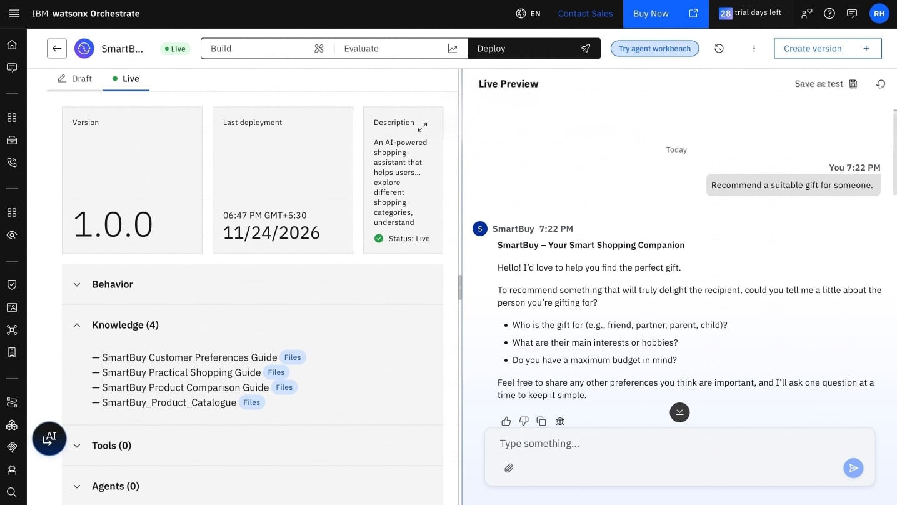

🛍️ SmartBuy – Your Smart Shopping Companion

An AI-powered shopping assistant built using IBM watsonx Orchestrate.

📌 Project Overview

SmartBuy is an AI-powered shopping assistant designed to help customers discover suitable products based on their needs, preferences, categories and budget.

It uses a product catalogue and shopping-related knowledge documents to provide relevant recommendations, compare products and help customers make informed shopping decisions.

🎯 Objectives

- Help customers find suitable products.
- Provide recommendations based on customer preferences.
- Apply strict budget filtering.
- Compare products and explain their differences.
- Reduce unsupported product claims through knowledge-based responses.
- Improve the overall shopping experience using AI.

✨ Key Features

- Product Recommendations: Suggests suitable products based on customer requirements.
- Budget Filtering: Recommends only products within the specified budget.
- Category Filtering: Helps customers find products from relevant categories.
- Product Comparison: Explains differences between selected products.
- Preference Matching: Considers customer needs and intended use.
- Knowledge-Based Responses: Uses uploaded product and shopping knowledge documents.
- Unsupported Information Handling: Avoids inventing missing product specifications.

🛠️ Technologies & Tools

- IBM watsonx Orchestrate
- AI-powered agent development
- Knowledge-based retrieval
- Prompt engineering
- Product catalogue and knowledge documents

📚 Knowledge Base

The SmartBuy agent uses four knowledge documents:

1. SmartBuy Sample Product Catalogue
2. Practical Shopping Guide
3. Product Comparison Guide
4. Customer Preferences Guide

🧪 Testing and Evaluation

SmartBuy was tested using different shopping scenarios, including:

- Product discovery
- Strict budget constraints
- Category-based filtering
- Product comparisons
- Customer preference matching
- Missing product specifications
- Unavailable products
- Duplicate product removal
- Conflicting customer requirements

The agent's instructions were refined based on the testing results.

🚀 Deployment

SmartBuy was deployed using IBM watsonx Orchestrate.

Deployed Version: 1.0.0 – SmartBuy Initial Release

Status: Live

📸 Project Screenshots

Add screenshots of your SmartBuy agent here to demonstrate its interface and capabilities.

Suggested screenshots:

- SmartBuy agent interface
- Knowledge base documents
- Product recommendation response
- Product comparison response
- Live deployment status

🔮 Future Enhancements

- Integration with additional product catalogues.
- Improved personalization.
- Integration with e-commerce platforms.
- Additional shopping categories.
- Enhanced conversational shopping experience.

👩‍💻 Project Information

Project Name: SmartBuy – Your Smart Shopping Companion

Platform: IBM watsonx Orchestrate

Version: 1.0.0

Project Type: AI Shopping Assistant
 
 
## 📸 Project Screenshots

### SmartBuy – Live Deployment

---

Built as an AI agent development project to explore prompt engineering, knowledge-based AI, product recommendations and conversational shopping experiences.
